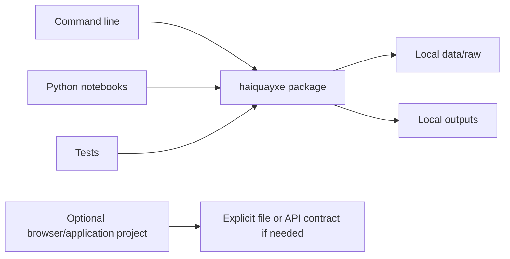

# Architecture and extension guide

## Design goals

1. Any teammate can reproduce the setup with one command.
2. Shared logic is importable and testable outside the repository's current directory.
3. Experiments can change quickly without destabilizing submission code.
4. Raw input, derived outputs, and source code have clear ownership and locations.
5. Every added component serves a confirmed task; the 2026 solution is not assumed.

## Boundaries

| Area | Responsibility | Avoid |
| --- | --- | --- |
| `src/haiquayxe/` | Reusable parsing, evaluation, model, and export functions as tasks arrive | Network calls or training at import time; editor-specific absolute paths |
| `cli.py` | Parse arguments, call functions, report readable failures | Duplicated model/validation logic |
| `scripts/` | Setup and repository maintenance; old command compatibility | A second implementation of package logic |
| `notebooks/` | Exploration and narrative; import tested package functions | A second hidden copy of production logic; committed private outputs |
| `apps/<name>/` | Self-contained app with its own README and dependencies if required | Choosing a web framework before the task; coupling app setup to every Python user |
| `data/raw/` | Original downloads, unchanged and untracked | Preprocessing in place |
| `outputs/` | Regenerable submissions, metrics, models, reports | Treating a local result as a published deliverable |
| `tests/` | Synthetic cases, regression checks, command-line integration | Private competition data or tests that merely repeat implementation |

The package currently contains environment and submission utilities only. Add `data.py`, `evaluation.py`, or a task-specific subpackage when real functionality requires it. No empty model/service layers are needed in advance.

## Paths and portability

Command-line file paths are explicit and relative to the caller's working directory unless absolute. Run README examples from the repository root. Setup scripts locate their own repository root. The installed package does not depend on `sys.path` modifications or running from a particular directory.

## Input/output contracts

Inspect actual schemas before implementing adapters. Keep IDs as strings, document the positive class and target direction, and fit learned preprocessing only on the training split. Export through a tested function; validate the generated artifact against the official template before uploading. The existing validator is intentionally limited to binary probabilities.

If Python results feed a browser app, define a small JSON/file contract first. Add a backend only when the task requires one. Application hosting, secrets, and model-provider credentials are not configured until needed.

## Reproducibility

Each experiment should record the Git commit, data source/version, split strategy, seed, model/prompt settings, dependency snapshot, metric, score, runtime, and output location. Use `outputs/<run-name>/` to keep runs distinct. See the experiment template.

## Checks and delivery

Bootstrap -> dependency smoke check -> lint/format -> unit/CLI tests -> repository hygiene -> review -> CI -> merge. CI covers Windows/Linux on Python 3.11/3.12 and uses pinned action revisions. It verifies source, not performance on missing competition data.

Keep reusable source in this layout. Build each required final deliverable into `outputs/` first. If the organisers require a tracked submission directory or public assets, create that exact directory after checking the official contract and sharing rules; do not submit `apps/` or the repository root by assumption.

## Current limits

Official 2026 tasks and data are not available here. No competition model, game, API service, deployment, or final submission exists yet. GitHub access, protected branches, and contest enrollment are separate from local setup.
