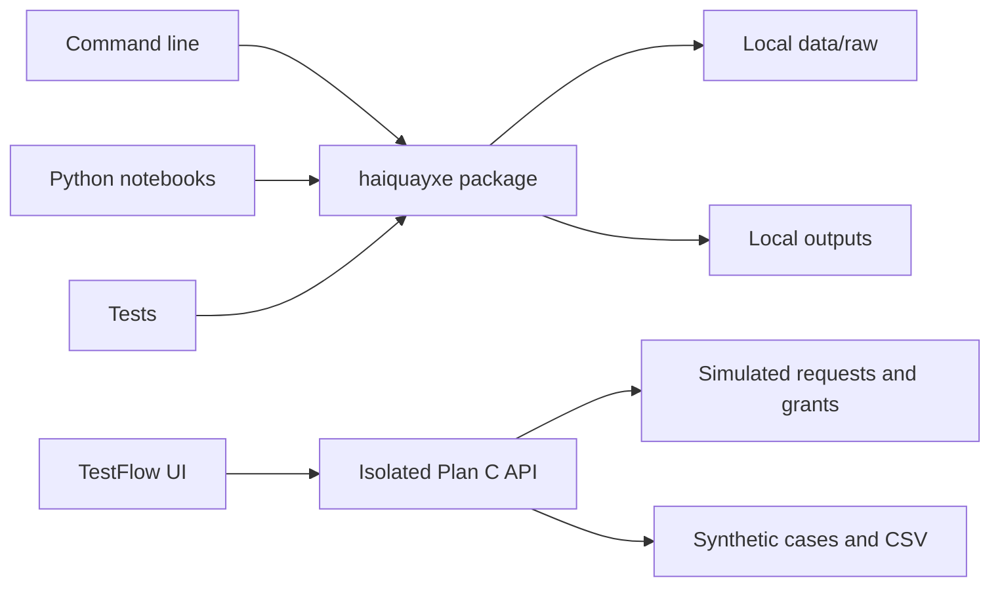

# Architecture

The repository contains two independent competition deliverables. Challenge 1 runs model training on Kaggle. Challenge 2 is TestFlow, a Next.js testing workspace. Neither requires the other's runtime.

## TestFlow

The Plan C UI at `/demo` calls only `/api/demo/*`. `lib/demo.ts` maintains isolated in-memory sessions, requests, grants, synthetic cases and activity in one Node process. A serialized mutation queue ensures duplicate approvals cannot race. Reset or restart clears the simulation.

Saving a request grants nothing. Two different eligible demo stewards must approve before the server grants its capability. Editing and export require separate capabilities, checked on every protected action. The identity selector deliberately simulates the actors; it is not a production identity service.

`TESTFLOW_DEMO_MODE=1` enables the simulation. Demo cookies apply only to `/api/demo`; they cannot authenticate the retained live API. `components/tide-entry.tsx` and the live APIs retain the Tide SDK path and its token checks. The [integration map](c2-plan-c.md) explains where verified Tide identities and signed policy replace simulated authority.

## Challenge 1

`notebooks/RMIT_SGS_HaiQuayXe_C1.ipynb` is self-contained for Kaggle. It loads the approved attached checkpoint and competition data, checks the split, trains, evaluates and exports audited predictions. It does not require the local Python package inside Kaggle.

`src/haiquayxe/` supplies local environment and submission-validation commands. Competition files remain in ignored `data/raw/`. Logs, receipts, metrics, predictions and model artifacts remain in ignored `outputs/`. The [Kaggle guide](kaggle-c1-guide.md) records the accepted model and experiment history.

## Shared repository conventions

## Design goals

1. Any teammate can reproduce the setup with one command.
2. Shared logic is importable and testable outside the repository's current directory.
3. Experiments can change quickly without destabilizing submission code.
4. Raw input, derived outputs, and source code have clear ownership and locations.
5. Each component serves a confirmed competition requirement.

## Boundaries

| Area | Responsibility | Avoid |
| --- | --- | --- |
| `src/haiquayxe/` | Reusable parsing, evaluation, model, and export functions as tasks arrive | Network calls or training at import time; editor-specific absolute paths |
| `cli.py` | Parse arguments, call functions, report readable failures | Duplicated model/validation logic |
| `scripts/` | Setup and repository maintenance; old command compatibility | A second implementation of package logic |
| `notebooks/` | Exploration and narrative; import tested package functions | A second hidden copy of production logic; committed private outputs |
| `apps/<name>/` | Self-contained app with its own README and dependencies if required | Choosing a web framework before the task; coupling app setup to every Python user |
| `data/raw/` | Original downloads, unchanged and untracked | Preprocessing in place |
| `outputs/` | Regenerable submissions, metrics, models, reports | Treating a local result as a published deliverable |
| `tests/` | Synthetic cases, regression checks, command-line integration | Private competition data or tests that merely repeat implementation |

The Python package contains environment and submission utilities. Model training remains in the Kaggle notebook; TestFlow owns its own Node dependencies and API contracts.

## Paths and portability

Command-line file paths are explicit and relative to the caller's working directory unless absolute. Run README examples from the repository root. Setup scripts locate their own repository root. The installed package does not depend on `sys.path` modifications or running from a particular directory.

## Input/output contracts

Keep IDs as strings and fit learned preprocessing only on training rows. The C1 validator checks the three-class label format and exact sample IDs; legacy binary-probability validation remains a separate command. TestFlow exports its eight synthetic cases with all 11 fields and protects spreadsheet consumers from formula injection.

C1 predictions do not feed TestFlow. The app demonstrates permission governance independently of classifier performance.

## Reproducibility

Each experiment should record the Git commit, data source/version, split strategy, seed, model/prompt settings, dependency snapshot, metric, score, runtime, and output location. Use `outputs/<run-name>/` to keep runs distinct. See the experiment template.

## Checks and delivery

Bootstrap -> dependency smoke check -> lint/format -> unit/CLI tests -> repository hygiene -> review -> CI -> merge. CI covers Windows/Linux on Python 3.11/3.12 and uses pinned action revisions. It verifies source, not performance on missing competition data.

C1 is delivered through Kaggle. The C2 package contains this repository's source, project overview and MP4 in `demo/`; the repository URL is submitted through the official form.

## Current limits

Real Tide activation and cryptographic approvals remain unverified. Official Plan C permits the clearly labelled simulation with equal judging treatment. Activity is an ordinary application log, not tamper-proof evidence; there is no Jira connection, end-to-end encryption or malicious-host protection claim. Demo state is intentionally temporary and supports one local server process.
